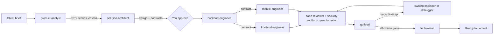

# agents-workflow

A senior AI delivery team for Claude Code: 14 specialist subagents and 6 workflow commands for building a website, a web app, and a mobile app, from the client brief and estimate through architecture, build, review, QA, and release.

Default stack: TypeScript everywhere. Next.js for the website and web app, a Node API, PostgreSQL, and React Native + Expo for iOS and Android, in a pnpm + Turborepo monorepo. The agents follow whatever a project's `CLAUDE.md` and ADRs decide.

## Install

```bash
./install.sh                         # symlink into ~/.claude: every project sees the team
./install.sh --project ~/code/acme   # copy into ~/code/acme/.claude: commit it, customize per client
./install.sh --uninstall             # remove the symlinks this repo created
./install.sh --dry-run               # preview any of the above
```

Start a new Claude Code session after the first install. The script never overwrites existing files. Edits in this repo go live everywhere through the symlinks, so don't move this folder without uninstalling first.

## Use

| When | Run |
|---|---|
| Quoting a client | `/team-estimate path/to/brief.md` |
| Starting the project | `/team-kickoff` |
| Building a story | `/team-feature AUTH-01` |
| Fixing a bug | `/team-bugfix "checkout crashes on Android after payment"` |
| Before merging | `/team-review` |
| Shipping | `/team-release 1.0.0` |

Small jobs don't need a workflow. Call one agent directly: `@agent-debugger the login test fails only on CI`, or "use the security-auditor on src/auth".

Your main session acts as tech lead. It delegates, runs independent agents in parallel, and stops for your approval at requirements, design, paid services, and release. Nothing is committed, deployed, or submitted to a store unless you say so.

## The team

| Agent | Model, effort | Role | Writes |
|---|---|---|---|
| product-analyst | opus, high | PRD, stories, acceptance criteria, estimates, change requests | docs/product |
| solution-architect | opus, xhigh | stack, architecture, API contracts, ADRs, technical designs | docs/architecture, docs/adr, docs/design |
| ui-ux-designer | sonnet | flows, screen states, design system and tokens, accessibility specs | docs/ux, tokens package |
| frontend-engineer | sonnet | website and web app (Next.js) | web code and tests |
| backend-engineer | sonnet | API, database, auth, jobs, shared contracts | server code, migrations, tests |
| mobile-engineer | sonnet | iOS and Android app (Expo) | mobile code and tests |
| code-reviewer | opus, high | staff-level code review | read-only |
| security-auditor | opus, high | OWASP, ASVS, and MASVS audit | read-only |
| performance-engineer | sonnet | budgets, profiling, optimization | audit report, or fixes when asked |
| qa-lead | opus, high | test strategy, acceptance verification, bug reports, release sign-off | docs/qa |
| qa-automation | sonnet | unit, integration, Playwright, and Maestro tests; CI test gates | test code |
| debugger | opus, high | reproduce, root cause, minimal fix, regression test | the fix and its test |
| devops-engineer | sonnet | CI/CD, environments, deploys, EAS releases, monitoring | CI, config, runbooks |
| tech-writer | sonnet | README, API docs, changelog, release notes, client handover | docs |

Agents without a fixed effort use your session's effort level.

## How it works



- **Shared standards.** The `team-standards` skill is preloaded into every agent: docs layout, engineering principles, Definition of Done, handoff report format, severity scale, and safety rules.
- **The repo is the team's memory.** Agents don't share conversations; they share files. Each one reads `CLAUDE.md` and `docs/` before acting and writes its output there. The same docs become the client handover.
- **Roles enforced by config.** code-reviewer and security-auditor have no Edit or Write tools. No agent can start other agents, so coordination and cost stay in your main session.
- **Evidence over claims.** Every agent ends with a handoff report: status, artifacts, decisions, the commands it ran and their results, findings, and the next step.

## Customize

- **Models and effort**: edit `model:` and `effort:` in `agents/*.md`. To put everything on Opus: `sed -i 's/^model: sonnet/model: opus/' agents/*.md`.
- **Per-client changes**: `./install.sh --project <repo>`, then edit the copies. Project agents override global agents with the same name.
- **Another stack** (Flutter, for example): rewrite the stack-specific sections of `mobile-engineer`, `qa-automation`, and `devops-engineer`. The other agents are stack-neutral.
- **Persistent agent memory**: add `memory: local` to an agent so it keeps notes across sessions. Memory turns on Write and Edit automatically, so don't add it to the read-only reviewers.
- **A new agent**: copy an existing file and change `name` (must match the file name), `description` (when to use it), and the prompt. Keep `skills: [team-standards]`, and end the prompt with the handoff report.

After editing, run the linter. `claude plugin validate` accepts broken frontmatter; this script catches it:

```bash
python3 scripts/validate.py
```

## Cost

A full `/team-feature` run can start 6–9 agents. Opus covers the judgment roles and Sonnet does the building. For small changes, let `/team-feature` take its trivial path, or call one agent directly.

## Layout

```
agents/                                  14 subagent definitions
skills/team-standards/                   shared rules, preloaded into every agent
skills/team-{estimate,kickoff,feature,bugfix,review,release}/   workflow commands
skills/team-kickoff/templates/CLAUDE.md  project brief template
scripts/validate.py                      frontmatter linter
install.sh                               install and uninstall
```
